## What I'm working on

### Voice-Controlled, AI-Assisted Robotic Arm with Adaptive Grasp Recovery

**Goal:** Develop a voice-controlled robotic arm capable of identifying and sorting previously unseen objects into freely positioned containers, autonomously verifying grasp success, detecting failures, and adapting its actions through visual feedback.

**Planned Development:** The system will combine workspace calibration using ArUco markers, camera-based object localization, inverse kinematics, and closed-loop visual servoing for precise manipulation. Depth sensing, including stereo vision and dedicated depth cameras, will be evaluated to improve spatial perception and grasp accuracy.

A key focus will be **adaptive grasp recovery**, combining visual feedback with servo telemetry to detect unsuccessful grasps, estimate possible failure causes, and execute bounded corrective actions rather than simply repeating failed movements.

**AI Integration:** OpenAI Whisper is planned for speech recognition, while the Gemini API will support object recognition, natural-language task interpretation, and clarification of ambiguous commands. A local web interface will provide manual control, live camera feedback, and execution monitoring.

**Software Architecture:** The software will follow a modular architecture separating perception, task planning, motion control, and failure recovery. Hugging Face LeRobot will be evaluated for hardware integration, with ROS 2 and MoveIt considered for more advanced motion planning and collision avoidance.

**Experimental Evaluation:** A central research objective will be to investigate how different feedback mechanisms influence the reliability of autonomous robotic manipulation. Controlled experiments will compare **open-loop grasping, vision-based grasp verification, and combined visual and servo-based feedback with adaptive recovery strategies**. Performance will be evaluated using grasp success rates, recovery effectiveness, positioning accuracy, and task completion times across different objects and container configurations.

**Status:** Planning and hardware evaluation, with the SO-101 and SO-ARM102 under consideration.

### Magnetic bottles & auroras

**Planned approach:** Simulate charged-particle trajectories under the Lorentz force using a Boris integrator and compare selected results with a fourth-order Runge–Kutta method (RK4).

I plan to validate the simulations against analytical trajectories in a uniform magnetic field, investigate time-step convergence, and measure energy drift over long integration times. For magnetic-bottle configurations, I will vary initial speed and pitch angle and compare confinement and escape with predictions from magnetic-mirror theory.

**Focus:** Connecting physical explanations with numerical simulations, quantified numerical errors, and clear visualizations.

**Status:** Planning and simulation design.

## Experimental work - 1st place in Germany’s national Jugend testet competition 

Together with a teammate, I won first place nationally in **Jugend testet 2025**, a competition organized by **Stiftung Warentest**, Germany’s well-known independent consumer testing organization, for our investigation of kitchen paper towels.

We programmed an ESP32 microcontroller to control a motorized test arm and transmit experimental data over Wi-Fi to a Python-based system for automated data processing, statistical analysis, and visualization. This experience strengthened my interest in reproducible experiments, measurement, and the connection between hardware and data.

https://www.suedkurier.de/region/hochrhein/bad-saeckingen/ganz-schoen-pfiffig-saeckinger-schueler-holen-ersten-preis-beim-bundeswettbewerb-jugend-testet;art372588,12430724

https://www.test.de/Jugend-testet-2025-Ausgezeichnete-Talente-6223403-0/

**Code and visualizations coming soon.**

## Languages and Tools

  
  
  
  
  
  
  
  
  
  
  
  
  
  
  
  

## How I work

I focus on substantial projects, combining theoretical understanding with implementation and testing. I aim to make my work reproducible, explain design decisions, and document both successful results and limitations.
